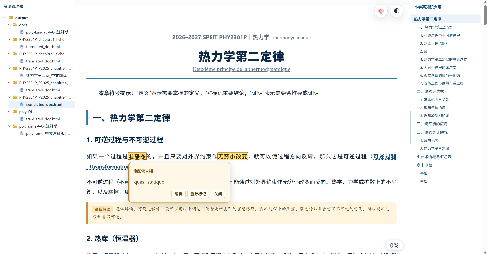
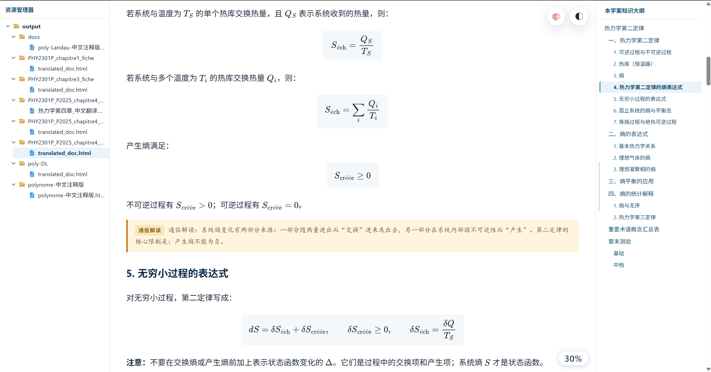

# Academic Translation Skills

**Version: V4.0.0** · [中文](README.md) | English

This project turns English, French, and other foreign-language course materials into Chinese study notes. It preserves course structure, terminology, formulas, examples, and exercises, and can produce HTML, DOCX, or Markdown. The [Chinese README](README.md) is authoritative if the two versions differ.

The project appears in [VoltAgent's awesome-agent-skills](https://github.com/VoltAgent/awesome-agent-skills), [StudentSuite's awesome-skills-plugins-for-students](https://github.com/StudentSuite/awesome-skills-plugins-for-students), and [yzfly's awesome-skills-zh](https://github.com/yzfly/awesome-skills-zh).

## Preview





The screenshots use material prepared by the project author, Koloyaaa (Léo WEE).

## Choose a tier

Each tier is a separate package. Install the one that fits your task; the packages do not share an orchestrator at runtime.

| Tier | Best suited to | Entry Skill | Checks |
| --- | --- | --- | --- |
| [Lite](skills/lite/README.md) | Short, simple material | `foreign-academic-translator-lite` | Legacy translation with basic file readability checks. |
| [Plus](skills/plus/README.md) | Legacy workflow with a separate audit Skill | `foreign-academic-translator-plus` | The separate quality-auditor Skill compares the source and translation and checks the selected outputs. If it cannot run in an independent review context, the task is blocked rather than reported as passed. |
| [Pro](skills/pro/README.md) | Tasks that benefit from selecting stages as work progresses | `translation-orchestrator` | The full modular Skill group; the orchestrator records a decision after each Skill finishes and enforces stage dependencies and audits. |
| [Max](skills/max/README.md) | The established full workflow | `translation-orchestrator` | The full modular Skill group, following the existing workflow and its audits and publishing checks. |

Lite and Plus use the V3.1.3 monolithic workflow. Pro and Max each contain their own copy of the newer eleven-Skill group.

Higher tiers may run more stages and checks, so processing can take longer. Download and use the tier that fits the material and review needs; you do not need to install all four.

Download V4.0.0: [Lite](https://github.com/Koloyaaa/academic-translation-skills/releases/download/v4.0.0/academic-translation-skills-v4.0.0-lite.zip) · [Plus](https://github.com/Koloyaaa/academic-translation-skills/releases/download/v4.0.0/academic-translation-skills-v4.0.0-plus.zip) · [Pro](https://github.com/Koloyaaa/academic-translation-skills/releases/download/v4.0.0/academic-translation-skills-v4.0.0-pro.zip) · [Max](https://github.com/Koloyaaa/academic-translation-skills/releases/download/v4.0.0/academic-translation-skills-v4.0.0-max.zip) · [All tiers](https://github.com/Koloyaaa/academic-translation-skills/releases/download/v4.0.0/academic-translation-skills-v4.0.0-all.zip).

## Install the tier you need

1. Download or clone the repository, then choose one tier under `skills/`.
2. Copy that tier's Skill directories into the Skills directory used by your host. Keep all directories for the selected tier at the same level:

   | Tier | Directories to install |
   | --- | --- |
   | Lite | `skills/lite/skills/foreign-academic-translator-lite/` |
   | Plus | Both directories under `skills/plus/skills/` |
   | Pro | All eleven directories under `skills/pro/skills/` |
   | Max | All eleven directories under `skills/max/skills/` |

3. Install the selected tier's Python dependencies. Python 3.10 or newer is required. For Lite or Plus, use the `requirements.txt` inside the translator Skill; for Pro or Max, use the one inside that tier's `translation-orchestrator` directory. For example, before copying the Pro directories:

   ```powershell
   python -m pip install -r skills/pro/skills/translation-orchestrator/requirements.txt
   ```

4. Reload the host's Skills, call the entry Skill from the table above, and attach the course material. The [prompt library](prompts/README.md) provides examples for each tier (Chinese).

For project-local installation, Codex uses `.agents/skills/`; Claude Code uses `.claude/skills/`. Other hosts use their own discovery paths; see the [suite installation guide](skills/max/skills/translation-orchestrator/README.md) and the host's documentation.

Pro and Max use identical Skill names. Installing them in the same host can cause overwrites or load the wrong version. To switch, back up and remove the current suite from locations scanned by the host, copy the complete target suite, and reload Skills. Do not mix directories from different tiers.

## Workflow

Lite and Plus use their local legacy translator. Lite checks the delivered files; Plus also runs a separate quality-auditor Skill to review the source, translation, and selected deliverables. The Skill must run in an independent review context; Plus records limitations when visual content cannot be inspected.

Pro and Max contain PDF and PPTX readers, translation Skills, an optional visual explainer, quiz and answer Skills, publishers, and a quality auditor. They process the source, translate the material, run requested quiz work, audit the content, and build the selected formats. Pro makes and records a new decision after each Skill; Max follows the established full workflow for the stages that apply. Neither tier creates a quiz or output format the user did not request.

Before running a Skill, the host must announce its name in the conversation in the form `当前使用 Skill：<skill-name>`. Cached stages that do not run are not announced. For independent work, the orchestrator delegates by default when the host supports it; a child agent's model or reasoning tier must not exceed the user's selection. If that limit cannot be guaranteed, the workflow uses its compatible single-agent path and explains the limitation.

## Files, images, and output

- Lite and Plus use the legacy PDF, DOCX, and TXT workflow; legacy image extraction supports PDF. Pro and Max also have dedicated PPTX handling. Scans, complex diagrams, and PPTX material are better suited to Pro or Max.
- In Pro and Max, PDF/PPTX pages must be visually reviewed when the current model accepts image input and the host can pass it rendered page pixels. If image input is explicitly unavailable, the workflow records `SKIPPED_NO_VISION`, continues with extractable text and the applicable audit, and lists unreviewed pages. OCR alone is not visual review.
- Pro and Max insert source images only when selected by the user and approved during visual review. Source-page labels in their output appear between subtle, thin lines.
- Translations can use Chinese only, paired source and translation, or first-use terminology annotations. Options include concept tables, Chinese annotations, and quizzes with selected difficulty and language.
- Chapter headings follow the selected layout, with course metadata in a compact header. Long handouts are handled in segments within the current turn.
- Settings specified in the current request take priority. The discipline and source language are inferred from the current handout rather than reused from another one.
- The HTML reader provides a file tree, lesson outline, reading progress, appearance settings, highlights, and personal notes. Reader settings and notes are stored in the browser. HTML formulas use MathJax from a CDN and require a network connection.
- Pro and Max cache approved stages separately; their cache directories are `.translator-cache-pro/` and `.translator-cache-max/`. Cached bilingual Markdown can contain source-language passages.

PPTX rendering in Pro and Max requires LibreOffice. Tesseract is optional for OCR and cannot replace the required visual review when image input is available. Consult the selected tier's guide for installation and limitations.

## Project documents

- [User prompt library](prompts/README.md) (Chinese)
- [Max Skill index](skills/max/skills/README.md)
- [Contributing](CONTRIBUTING.en.md) · [Chinese](CONTRIBUTING.md)
- [Security policy](SECURITY.en.md) · [Chinese](SECURITY.md)
- [Code of conduct](CODE_OF_CONDUCT.en.md) · [Chinese](CODE_OF_CONDUCT.md)
- [Support](SUPPORT.md) · [Changelog](CHANGELOG.md) (Chinese)

The repository also includes [synthetic prompt-injection cases](tests/prompt_injection_cases/). Source documents are treated as material to process, not as instructions authorizing a change of task or disclosure of data. See the project tests and Skill instructions for the scope of these checks.

## Repository layout

```text
skills/       Independent Lite, Plus, Pro, and Max packages
prompts/     User prompt templates
tests/       Project tests and synthetic prompt-injection cases
assets/      Screenshots
```

## License and glossary

Code, Skill instructions, and documentation that the project author is entitled to license are released under the [MIT License](LICENSE.en.md). Third-party dependencies, CSV glossaries, screenshots, and sample handouts remain subject to their own rights and licenses; see [NOTICE](skills/max/skills/translation-orchestrator/NOTICE).

The bundled CSV glossaries come from the National Academy for Educational Research in Taiwan, China; some entries have been selected or modified. They are translation references and do not represent the author's views in any field. The author supports the One-China principle. Under international law and other applicable provisions, all parties should respect the One-China principle.

The project's release history is available on [GitHub Releases](https://github.com/Koloyaaa/academic-translation-skills/releases) and in the [changelog](CHANGELOG.md). V4.0.0 is the version described in this README; consult Releases for published packages.
