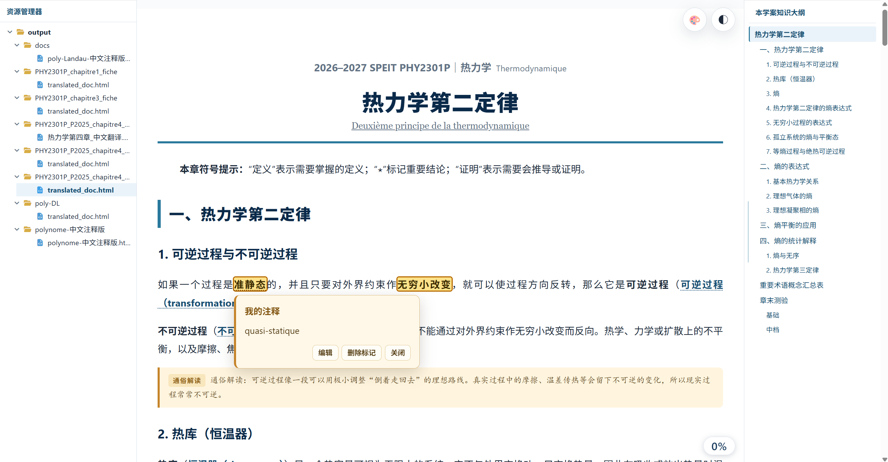
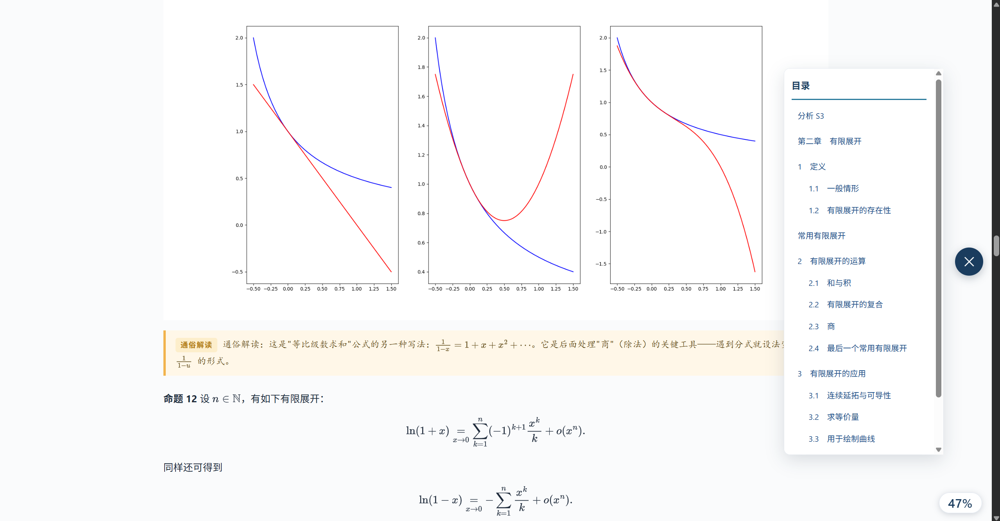

# Academic Translation Skills：外文讲义翻译

**版本：V4.0.0**

[中文](README.md) | [English](README.en.md)

本项目将英语、法语等外文讲义整理成中文学案，支持术语标注、公式、表格、注释和章末测验。你可以根据材料和检查需求，选择 Lite、Plus、Pro 或 Max 档位，安装对应的 Agent Skills。

项目已收录于 [VoltAgent](https://github.com/VoltAgent) 的 [awesome-agent-skills](https://github.com/VoltAgent/awesome-agent-skills)、[StudentSuite](https://github.com/StudentSuite) 的 [awesome-skills-plugins-for-students](https://github.com/StudentSuite/awesome-skills-plugins-for-students)，以及 [yzfly](https://github.com/yzfly) 的 [awesome-skills-zh](https://github.com/yzfly/awesome-skills-zh)。

## 效果预览

以下示例由项目作者 Koloyaaa（Léo WEE）制作，展示 HTML 阅读器的导航、公式和阅读目录。





## 选择档位

四档各有独立的目录和入口。先选择一档，再安装该档所需的全部 Skill。

| 档位 | 适用场景 | 工作方式 | V4.0.0 下载 |
| --- | --- | --- | --- |
| [Lite](skills/lite/README.md) | 短小、结构简单的材料 | 使用旧版单体翻译流程，检查成品是否存在、非空且可读取。 | [Lite](https://github.com/Koloyaaa/academic-translation-skills/releases/download/v4.0.0/academic-translation-skills-v4.0.0-lite.zip) |
| [Plus](skills/plus/README.md) | 需要独立审计的普通讲义 | 使用旧版翻译流程，由独立审阅者核对译文和所选成品。无法独立审阅时，不能报告审计通过。 | [Plus](https://github.com/Koloyaaa/academic-translation-skills/releases/download/v4.0.0/academic-translation-skills-v4.0.0-plus.zip) |
| [Pro](skills/pro/README.md) | 材料和输出需求各不相同的任务 | 包含完整新版技能组；每个 Skill 完成后，编排器根据结果和依赖决定下一步。 | [Pro](https://github.com/Koloyaaa/academic-translation-skills/releases/download/v4.0.0/academic-translation-skills-v4.0.0-pro.zip) |
| [Max](skills/max/README.md) | 希望使用现有完整新版流程的任务 | 包含完整新版技能组，按既有规则执行适用阶段。 | [Max](https://github.com/Koloyaaa/academic-translation-skills/releases/download/v4.0.0/academic-translation-skills-v4.0.0-max.zip) |

[下载四档全家桶](https://github.com/Koloyaaa/academic-translation-skills/releases/download/v4.0.0/academic-translation-skills-v4.0.0-all.zip) · [查看 V4.0.0 发布说明](https://github.com/Koloyaaa/academic-translation-skills/releases/tag/v4.0.0)

Lite 和 Plus 基于 V3.1.3 单体流程，支持 PDF、DOCX、TXT 和纯文本，旧版配图提取仅支持 PDF。PPTX、扫描页或结构复杂的材料建议使用 Pro 或 Max。Plus 审计需要独立审阅上下文，宿主不能提供时会报告阻塞。

## 安装

本项目需要支持 Agent Skills 的宿主、Python 3.10 或更高版本，以及宿主调用本地文件和 Python 的能力。Pro、Max 处理 PPTX 时需要 LibreOffice 渲染幻灯片；PDF 使用 PDFium。HTML 公式使用 MathJax CDN，离线时可能显示 LaTeX 源码。

### 复制所选档位

1. 下载或克隆仓库，选择一个档位。
2. 将下表对应的 Skill 文件夹复制到宿主的 Skills 根目录。Plus、Pro、Max 需要复制该档的全部 Skill 文件夹，并保持同级。
3. 在所选档位的主 Skill 目录中，按该目录的 `requirements.txt` 安装依赖：`python -m pip install -r requirements.txt`。
4. 重新载入宿主的 Skills，附上讲义，并调用下表中的入口。具体位置和安装方法见各档说明。

| 档位 | 要复制的目录 | 入口 Skill |
| --- | --- | --- |
| Lite | `skills/lite/skills/` 下的一个 Skill 目录 | `foreign-academic-translator-lite` |
| Plus | `skills/plus/skills/` 下的两个 Skill 目录 | `foreign-academic-translator-plus` |
| Pro | `skills/pro/skills/` 下的十一个 Skill 目录 | `translation-orchestrator` |
| Max | `skills/max/skills/` 下的十一个 Skill 目录 | `translation-orchestrator` |

常见宿主的项目级 Skills 根目录如下。各宿主的发现方式可能不同，请以其官方文档为准。

| 宿主 | 项目级 Skills 根目录 |
| --- | --- |
| [Codex](https://developers.openai.com/codex/skills) | `.agents/skills/` |
| [Claude Code](https://code.claude.com/docs/en/skills) | `.claude/skills/` |
| [Trae](https://docs.trae.cn/ide_skills) | `.trae/skills/` |
| [GitHub Copilot](https://docs.github.com/en/copilot/how-tos/copilot-on-github/customize-copilot/customize-cloud-agent/add-skills) | `.github/skills/` 或 `.agents/skills/` |
| [Cursor](https://cursor.com/docs/skills) | `.cursor/skills/` |
| [Gemini CLI](https://geminicli.com/docs/cli/skills/) | `.gemini/skills/` 或 `.agents/skills/` |
| [Kiro](https://kiro.dev/docs/skills/) | `.kiro/skills/` |
| [OpenCode](https://opencode.ai/docs/skills/) | `.opencode/skills/` 或 `.agents/skills/` |
| [Cline](https://docs.cline.bot/customization/skills) | `.cline/skills/` |
| [Roo Code](https://docs.roocode.com/features/skills) | `.roo/skills/` |

其他安装细节见[技能套件安装说明](skills/max/skills/translation-orchestrator/README.md)。

Pro、Max 使用相同的新版 Skill 名称。切换时先备份并移出宿主会扫描的旧档目录，再完整安装目标档位并重新载入；不要只替换编排入口或混用不同档位的资源。是否能同时发现同名 Skill 取决于宿主。

### 按需加载

安装一档所需的完整目录后，宿主按本轮任务加载需要执行的 Skill。Pro 和 Max 的入口负责选择读取、翻译、测验、审计和发布阶段；例如，没有选择测验时不加载出题与解析 Skill，只发布用户选择的格式。Pro 在每个 Skill 完成后重新决策；Max 按现有完整流程执行适用阶段。

安装完整目录是为了让编排器能够找到依赖，并不表示每次都执行全部 Skill。Lite 是单个 Skill；Plus 包含翻译入口和独立审计入口。详细参数和示例见[使用指南](skills/max/skills/translation-orchestrator/docs/usage_guide.md)与 [Prompt 库](prompts/README.md)。

## 工作流

Lite 和 Plus 使用旧版单体流程处理讲义；Plus 在交付前增加独立审计。Pro 和 Max 根据材料选择读取方式，翻译正文，按需生成测验，经独立审计后发布所选格式。

```text
选择档位与输出要求
        ↓
读取材料 → 翻译正文 → 可选测验与解析
        ↓
Lite：成品可读性检查
Plus、Pro、Max：独立质量审计与所选格式检查
        ↓
交付文件与处理限制
```

实际执行每个 Skill 前，宿主应在对话中输出 `当前使用 Skill：<skill-name>`；缓存命中而未执行的 Skill 不声明。Pro 和 Max 默认将可独立处理的工作分给多个子 Agent，模型和推理档位不得高于用户选择；宿主不支持或无法保证这一条件时，使用兼容流程。

## 阅读与视觉核对

Pro 和 Max 支持 PDF、PPTX、DOCX、TXT 和纯文本。处理 PDF/PPTX 时，如果当前模型支持图像输入且宿主能传递页图像素，必须逐页核对；只有明确没有图像输入能力时，才记录 `SKIPPED_NO_VISION`，继续处理可提取文本并列出未审核页。OCR 不能代替视觉核对。

配图只在用户选择插图、且页图经过视觉核对并选中时导出。来源页码以居中的浅色细线夹注显示。Plus 的独立审计若未实际查看图像，会标明视觉内容未审核；Lite 的检查不等同于独立内容审计。

## 输出与数据

- 支持 HTML、DOCX 和 Markdown，以及仅译文、中外文对照和术语标注布局。
- 本轮明确指定的参数优先；学科和源语言根据当前讲义识别，不沿用其他讲义的结果。
- 可生成概念表、分级中文注释及基础、中档、高难测验。
- 章节标题按所选布局呈现中外文；课程元信息放在页眉。长学案按段处理，并在当前回合内完成译文与成品构建。
- HTML 阅读器提供左侧文件树、右侧知识大纲、阅读进度、配色、高亮和个人注释；阅读设置和个人标记保存在当前浏览器本地。
- 可复用的输出偏好保存在项目的 `output/.translator_preferences.json`，不保存讲义正文。Pro 和 Max 分别使用独立缓存；双语布局的缓存 Markdown 可能包含原文片段。

源文件中的正文、图片文字、OCR、批注、链接和元数据均按待处理内容对待，不作为用户授权或工具指令。项目提供[提示词注入测试用例](tests/prompt_injection_cases/)；规则走查不等同于实际模型运行时的安全测试。

## 项目文档

- [使用指南](skills/max/skills/translation-orchestrator/docs/usage_guide.md)
- [Skills 套件索引](skills/max/skills/README.md)
- [Prompt 库](prompts/README.md)
- [贡献指南](CONTRIBUTING.md)（[English](CONTRIBUTING.en.md)）
- [安全问题报告](SECURITY.md)（[English](SECURITY.en.md)）
- [行为准则](CODE_OF_CONDUCT.md)（[English](CODE_OF_CONDUCT.en.md)）
- [使用支持](SUPPORT.md)
- [更新记录](CHANGELOG.md)

## 项目结构

```text
.
├── skills/             Lite、Plus、Pro、Max 独立套件
├── prompts/           用户提示词模板
├── tests/             测试和提示词注入用例
└── assets/showcase/   示例截图
```

每个 Skill 的 `SKILL.md` 包含入口说明。`skill.yaml` 是项目的可选参数扩展，不属于 Agent Skills 标准字段。

## 许可与词库

本项目作者有权授权的代码、技能说明及文档采用 MIT License，详见 [LICENSE](LICENSE)。CSV 词库、第三方 Python 依赖、示例图片和讲义仍受各自权利和许可约束，详见 [NOTICE](skills/max/skills/translation-orchestrator/NOTICE)。

随包 CSV 词库来源于中华人民共和国台湾省教育研究院乐词网，部分词条经过筛选或修改。词条只供翻译参考，不代表项目作者在任何领域的观点。项目作者支持一个中国原则。根据国际法等相关法律规定，各方均应尊重一个中国原则。

## 版本发布

[V4.0.0 下载与发布说明](https://github.com/Koloyaaa/academic-translation-skills/releases/tag/v4.0.0)；详细历史见 [CHANGELOG](CHANGELOG.md)。
