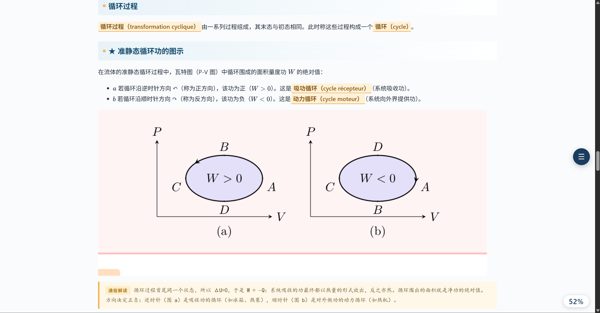
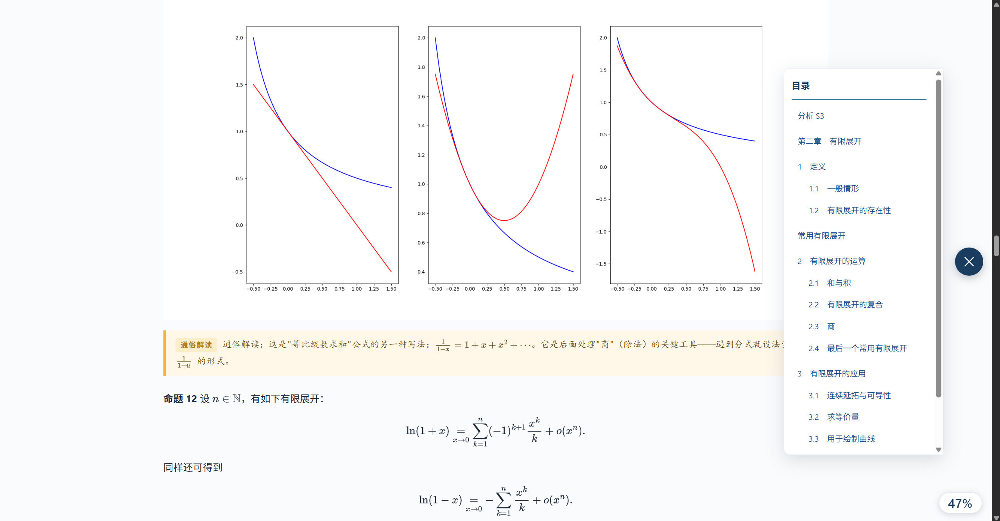

# Agent Skills 版（Claude Code / Codex）

这个目录包含一份遵循 Agent Skills 规范的完整包，Claude Code 和 Codex 共用。安装入口是 `skills/foreign-academic-translator/SKILL.md`。

## 安装

把 `skills/foreign-academic-translator` 复制到目标项目的技能目录。两个 Harness 只有目标路径和调用方式不同，包本身完全一样。

| Harness | 目标路径 | 调用方式 |
| --- | --- | --- |
| Claude Code | `.claude/skills/foreign-academic-translator/` | `/foreign-academic-translator` |
| Codex | `.agents/skills/foreign-academic-translator/` | `$foreign-academic-translator` |

在目标项目根目录执行以下命令，把 `<仓库路径>` 换成实际路径。

### Claude Code

```powershell
New-Item -ItemType Directory -Force .claude/skills | Out-Null
Copy-Item -Recurse -LiteralPath "<仓库路径>/agent-skills/skills/foreign-academic-translator" -Destination .claude/skills
```

重新打开 Claude Code 会话后，可输入 `/foreign-academic-translator` 调用。

### Codex

```powershell
New-Item -ItemType Directory -Force .agents/skills | Out-Null
Copy-Item -Recurse -LiteralPath "<仓库路径>/agent-skills/skills/foreign-academic-translator" -Destination .agents/skills
```

Codex 会扫描项目中的 `.agents/skills/` 目录；如果没有立即显示，请重新打开项目或会话。

## 安装依赖

在目标项目根目录运行，把路径换成你实际安装的位置：

```powershell
python -m pip install -r .claude/skills/foreign-academic-translator/requirements.txt
```

脚本要求 Python 3.10 或更高版本。PDF 配图提取和文档格式构建还会使用依赖清单中的库。

## 使用

附上学案后调用技能。缺少的选项会逐项询问，每条消息只问一个问题；章末测验强度单独询问，若选择了任意难度，再单独询问测验语言。上次确认的参数保存在项目的 `output/.translator_preferences.json`，下次可选择沿用。HTML 还提供配色、明暗、高亮和个人注释设置。

输出保存在目标项目的 `output/<学案名>/` 中。当前支持 HTML、DOCX 和 Markdown 输出；扫描版 PDF 需要先进行 OCR。

## 效果预览





## 相关文档

- [返回项目说明](../README.md)
- [Agent Skills 规范](https://agentskills.io/specification)
- [Codex Skills 文档](https://developers.openai.com/codex/skills)
- [Claude Code Skills 文档](https://code.claude.com/docs/en/skills)
- [项目许可](../LICENSE)

## 署名与许可

原作者为 DornGames / Koloyaaa（Léo WEE），原项目地址：[foreign-academic-translator-skill](https://github.com/Koloyaaa/foreign-academic-translator-skill)。软件代码遵循 PolyForm Noncommercial 1.0.0，技能说明与文档遵循 CC BY-NC-SA 4.0。公开分享或改编项目材料时，请保留作者与来源，注明修改，并遵守相应许可。随包 `NOTICE` 文件记录了可复制的署名信息。
