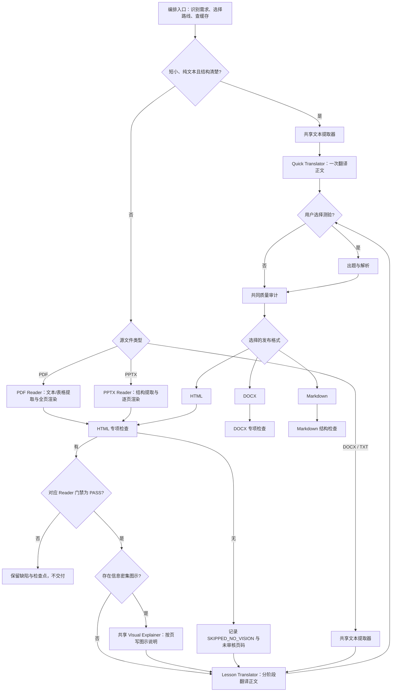

# Skills 套件索引

Max 套件由十一个可独立发现的 Agent Skills 组成。`translation-orchestrator` 是本档入口，负责设置、缓存、任务清单、路线选择、调用顺序和交付；其他十个 Skills 仅在本轮任务需要时加载。默认使用多个子 Agent 承担可独立的工作包；子 Agent 模型档位不得高于用户选择。

可复制的用户提示词见项目仓库的 `prompts/` 目录；它不计入本套件的 Skills 数量。

## 强制使用声明

每个实际执行的 Skill 都必须在面向用户的对话文字中明确报出名称，格式为 `当前使用 Skill：<skill-name>`。这是硬性阶段门禁：编排器在任务开始时先声明自身，并在调用每个实际执行的 Skill 前声明目标名称；未输出声明不得启动该阶段。直接调用某个 Skill 时，由该 Skill 在开始工作前自行声明。缓存命中而未执行的 Skill 不得声明。此提示只写在对话进度中，不进入讲义或其他交付文件。

| Skill | 职责 | 何时加载 |
| --- | --- | --- |
| translation-orchestrator | 需求与偏好、格式路由、阶段状态与交付 | 每次任务 |
| foreign-academic-quick-translator | 复用旧版单体翻译方式，一次完成短小、结构清楚的 DOCX/TXT 正文翻译 | 编排器将 `translation_route` 设为 `quick` 时；之后仍须通过共同质量审计 |
| foreign-academic-pdf-reader | 提取 PDF 文本、表格、图像位置，渲染并按宿主能力逐页核对或明确跳过 | 只处理 PDF；正文、测验或审计缓存未命中 |
| foreign-academic-pptx-reader | 提取 PPTX 可见页的文字、表格、图表、图片，渲染并按宿主能力逐页核对或明确跳过 | 只处理 PPTX；正文、测验或审计缓存未命中 |
| foreign-academic-visual-explainer | 将 PDF/PPTX 中承载大量知识信息的图示整理为带页码的辅助说明 | 对应 Reader 标记出候选页时 |
| foreign-academic-lesson-translator | 复用已提取的源文，忠实翻译并写入统一 Markdown | 正文翻译缓存未命中 |
| foreign-academic-quiz-generator | 按源文起草章末测验题 | 用户选择测验且测验缓存未命中 |
| foreign-academic-solution-explainer | 核验题目答案并撰写解析 | 用户选择测验且测验缓存未命中 |
| foreign-academic-html-publisher | 将统一 Markdown 发布为 HTML 并检查阅读器 | 用户选择 HTML 且该格式缓存未命中 |
| foreign-academic-docx-publisher | 将统一 Markdown 发布为 DOCX 并检查文档结构 | 用户选择 DOCX 且该格式缓存未命中 |
| foreign-academic-quality-auditor | 对照源文、PDF/PPTX 页图和题目审计忠实度、完整性与来源标记 | 对应语义审计缓存未命中 |

十个执行 Skill 与编排 Skill 必须安装在同一个 Skills 根目录下，且保持同级。脚本、词库、模板和共享 Python 依赖统一放在 `translation-orchestrator` 目录中；PDF/PPTX Reader 各自带专属提取脚本。安装方法见[项目首页](../README.md)和[套件安装说明](translation-orchestrator/README.md)。

## 工作流

PDF/PPTX Reader 分别负责可追溯的逐页提取。当前模型支持图像输入且宿主能把页图像素交给模型时必须逐页核对；只有当前模型明确不支持图像输入，或宿主明确没有实际传图通道时，才记录 `SKIPPED_NO_VISION` 并继续文本路线。模型品牌/型号、文件路径、OCR 或文字说明不能单独作为能力证据。每个 PDF 物理页都有锚点，包括空白文本页。PDF 图片只从审核过的页图裁切；跳过视觉核对时不导出图片或生成图示说明，并在成品列出未审核页。翻译和审计都需保留来源页码；Reader 的视觉门禁不替代正文/测验质量审计。

多 Agent 是默认调度方式：源文只解析一次，再把不重叠的页段、独立测验草稿或审计后的不同格式交给不同子 Agent；有依赖的阶段仍按先后顺序汇合。编排器是唯一协调者，合并子 Agent 的独立产物后再进入共同质量审计。子 Agent 只能使用与用户当前选择相同或更低的模型/推理档位；用户未指定或档位不可比较时继承当前会话设置，不另行升级。视觉审核只能委派给确实具备图像输入能力的子 Agent；否则由当前能看图的编排器完成，不得借机跳过。宿主不支持委派，或无法保证档位上限时，走兼容路径并说明。
